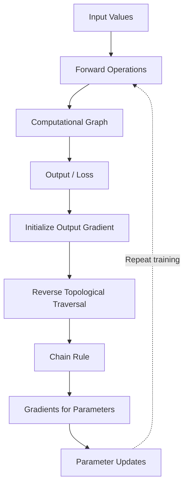
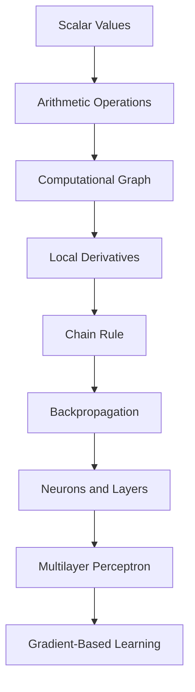

# ⚙️ MicroGrad — Automatic Differentiation From Scratch

<p align="center">
  
  
  
</p>

> Building the foundations of neural networks by implementing scalar-valued automatic differentiation and backpropagation.

## 🎯 Overview

MicroGrad is my implementation and exploration of the ideas behind [Andrej Karpathy's MicroGrad](https://github.com/karpathy/micrograd).

The central idea is simple: represent numerical values as nodes in a computational graph, track how operations connect those nodes, and compute derivatives using the chain rule.

This project helped me connect calculus with executable Python code and understand how gradients flow backward through a neural network.

## 🧠 Concepts Explored

| Concept | What I am learning |
|---|---|
| Scalar value objects | Store numerical data and gradient information |
| Computational graphs | Track dependencies between operations |
| Operator overloading | Represent addition and multiplication as graph operations |
| Local derivatives | Calculate derivatives for individual operations |
| Chain rule | Combine local derivatives to calculate gradients |
| Topological ordering | Process graph nodes in dependency order |
| Backpropagation | Propagate gradients backward from the output |
| Neurons and layers | Compose differentiable operations into a neural network |
| Multilayer perceptrons | Build networks from interconnected neurons |
| Gradient descent | Use gradients to update model parameters |

## 🔗 How Backpropagation Works



The forward pass calculates values. The backward pass calculates how sensitive the final output is to each value in the graph.

## 🏗️ Implementation Structure

```text
01-microGrad/
│
├── graphs/
│   ├── draw_graph.py
│   ├── graph.svg
│   ├── neuron_auto_backprop.svg
│   └── neuron_graph.svg
│
├── micrograd.py
├── MLP.py
├── main.py
└── README.md
```

- `micrograd.py` — scalar values, operations, and automatic differentiation.
- `MLP.py` — neuron, layer, and multilayer perceptron components.
- `main.py` — example execution and graph exploration.
- `graphs/` — graph visualization code and generated diagrams.

*File responsibilities reflect the current project layout; adjust descriptions if a file's implementation changes.*

## 🧮 The Core Idea

Consider the function:

\[
f(x,y)=xy
\]

Its partial derivatives are:

\[
\frac{\partial f}{\partial x}=y,
\qquad
\frac{\partial f}{\partial y}=x
\]

If \(x=2\) and \(y=3\), then:

\[
f(2,3)=6
\]

The gradients are:

\[
\frac{\partial f}{\partial x}=3,
\qquad
\frac{\partial f}{\partial y}=2
\]

An automatic differentiation engine computes these derivatives by recording the operations and applying the chain rule backward through the graph.

This is the fundamental mechanism that makes gradient-based neural network training possible.

## 🔍 Important Implementation Details

### 1. Store graph relationships

A value object can track its numerical value, gradient, parent nodes, and the operation that created it.

```python
class Value:
    def __init__(self, data, _children=(), _op=""):
        self.data = data
        self.grad = 0.0
        self._prev = set(_children)
        self._op = _op
```

This is a simplified illustration of the value object, not a replacement for the full implementation.

### 2. Define local derivatives

Each supported operation must define how its output changes with respect to its inputs.

### 3. Apply the chain rule

For a graph where \(z=f(y)\) and \(y=g(x)\):

\[
\frac{dz}{dx}
=
\frac{dz}{dy}
\frac{dy}{dx}
\]

The derivative of the final output is propagated backward, combining local derivatives at every node.

### 4. Accumulate gradients

A node can influence the final output through multiple paths. Its gradient contributions must be added together rather than overwritten.

### 5. Traverse in the correct order

A topological ordering ensures that gradients from downstream operations are available before propagating them farther backward.

## 🧪 Experiments and Debugging Lessons

The implementation and learning process explore:

- Numerical gradients versus analytical gradients.
- Derivatives of addition, multiplication, and nonlinear activations.
- Recursive graph traversal and topological sorting.
- Gradient accumulation when graph branches converge.
- The effect of gradient initialization and repeated backward passes.
- How neuron outputs combine weighted inputs and bias.
- How neurons form layers and layers form an MLP.

These experiments help validate the engine and reveal common errors in manual differentiation.

## ▶️ Running the Code

From the repository root, activate your project environment and run the relevant Python files:

```bash
uv sync
uv run python 01-microGrad/main.py
```

The command assumes `main.py` is executable from the repository root and dependencies are declared in `pyproject.toml`. Adjust the command if the entry point changes.

## 📖 What I Learned

- A gradient measures the local sensitivity of an output to a variable.
- A computational graph records how a result depends on its inputs.
- The chain rule connects local derivatives into a complete derivative.
- Backpropagation is an efficient application of the chain rule to a computational graph.
- Gradient accumulation matters when a variable contributes through multiple paths.
- Neural networks are compositions of differentiable operations.
- Debugging gradient logic requires understanding both the mathematics and the graph structure.

## Why am I learning MicroGrad?

I am learning deep learning through [Andrej Karpathy's Zero to Hero series](https://karpathy.ai/zero-to-hero.html).

Before relying on high-level frameworks such as PyTorch, I want to understand what happens underneath a neural network: how mathematical operations are connected, how derivatives are calculated, how gradients flow backward, and how parameters are updated during training.

MicroGrad is my starting point because it makes these mechanisms visible in a small Python implementation.

My objective is not just to make the code run. I want to understand each operation, explain its mathematics, debug it independently, and build on the same foundations when learning larger neural networks.

## What is MicroGrad?

MicroGrad is a small automatic differentiation engine inspired by [Karpathy's MicroGrad](https://github.com/karpathy/micrograd).

It works with scalar values and records the operations that connect them in a computational graph. Once the forward computation is complete, it can calculate derivatives by applying the chain rule backward through the graph.

The project connects four important ideas:

- **Computational graphs:** represent dependencies between mathematical operations.
- **Automatic differentiation:** calculate derivatives by applying local derivative rules.
- **Backpropagation:** propagate gradients from an output toward earlier operations.
- **Neural networks:** combine differentiable operations into neurons, layers, and multilayer perceptrons.

## The learning journey



Each step builds on the previous one. Understanding scalar differentiation makes it easier to understand how a neural network computes and propagates gradients.

## What I implemented and explored

| Component | Purpose |
|---|---|
| `Value` | Stores scalar data, gradients, and graph relationships |
| Arithmetic operations | Build differentiable expressions |
| Backward functions | Define local gradient propagation |
| Topological traversal | Process graph nodes in the required dependency order |
| Graph visualization | Inspect how values and operations are connected |
| `Neuron` | Combines weighted inputs, bias, and an activation |
| `Layer` | Groups neurons |
| `MLP` | Composes multiple layers into a neural network |

See [`concepts.md`](./concepts.md) for the detailed learning notes, mistakes, debugging lessons, equations, and progression.

## The core idea

Consider a simple computation:

\[
L=(ab+c)d
\]

The forward pass calculates the value of \(L\). The backward pass calculates how sensitive \(L\) is to each input.

For example:

\[
\frac{\partial L}{\partial a}=bd
\]

\[
\frac{\partial L}{\partial b}=ad
\]

\[
\frac{\partial L}{\partial c}=d
\]

These derivatives tell us how changes to the inputs affect the final result. In a neural network, the same principle applies to weights and biases.

## What made this challenging?

My learning process involved more than implementing the classes. I had to work through several underlying ideas:

- Understanding why gradients are accumulated instead of overwritten.
- Following the chain rule through a computational graph.
- Understanding recursive depth-first traversal and topological sorting.
- Comparing numerical gradients with analytical derivatives.
- Understanding why backward passes can produce incorrect results if gradient state is handled improperly.
- Learning how `zip`, generators, list comprehensions, and object methods help build a neural network.
- Connecting individual neurons to layers and a complete MLP.

These debugging experiences are documented in [`concepts.md`](./concepts.md), alongside the corrections and reasoning behind them.

## Repository structure

```text
01-microGrad/
├── graphs/
│   ├── draw_graph.py
│   ├── graph.svg
│   ├── neuron_auto_backprop.svg
│   └── neuron_graph.svg
├── micrograd.py
├── MLP.py
├── main.py
├── README.md
└── concepts.md
```

## Running the implementation

From the repository root:

```bash
uv sync
uv run python 01-microGrad/main.py
```

This command assumes the entry point and dependency configuration remain as shown. Adjust it if the current script requires a different working directory.

## What comes next?

MicroGrad establishes the foundation for my next module, Makemore, where I am learning character-level language modeling.

The connection is important: automatic differentiation and backpropagation help explain how neural language models learn their parameters from data.

## Learning resources

- [Neural Networks: Zero to Hero](https://karpathy.ai/zero-to-hero.html)
- [Karpathy's MicroGrad implementation](https://github.com/karpathy/micrograd)

This is an educational learning project inspired by these resources. The code, experiments, and notes are maintained in this repository as my understanding develops.
