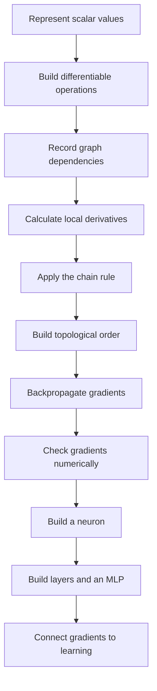
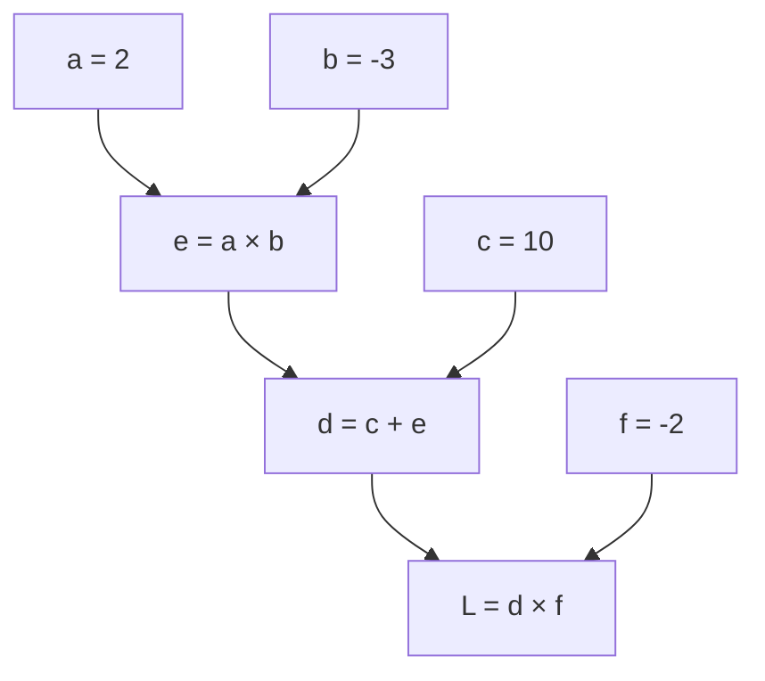
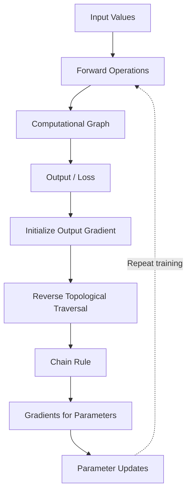

# 🧠 MicroGrad — Concepts, Mistakes & Learning Progression

> Personal learning notes for Andrej Karpathy's Zero to Hero, Video 1: MicroGrad.

These notes document my understanding as I work through the code, derive the mathematics, debug errors, and connect individual operations to neural network training.

The goal is to understand the implementation well enough to reproduce it and explain the reasoning without depending on the original video.

---

## Table of Contents

1. [Learning progression](#1-learning-progression)
2. [Scalar values and computational graphs](#2-scalar-values-and-computational-graphs)
3. [The `Value` class](#3-the-value-class)
4. [Operator overloading](#4-operator-overloading)
5. [Derivatives and the chain rule](#5-derivatives-and-the-chain-rule)
6. [Numerical versus analytical gradients](#6-numerical-versus-analytical-gradients)
7. [Backpropagation](#7-backpropagation)
8. [Topological sorting using DFS](#8-topological-sorting-using-dfs)
9. [The gradient accumulation bug](#9-the-gradient-accumulation-bug)
10. [Activation functions and `tanh`](#10-activation-functions-and-tanh)
11. [From a neuron to an MLP](#11-from-a-neuron-to-an-mlp)
12. [Python concepts I had to understand](#12-python-concepts-i-had-to-understand)
13. [Derivative practice and corrections](#13-derivative-practice-and-corrections)
14. [Mistakes and debugging record](#14-mistakes-and-debugging-record)
15. [What I understand now](#15-what-i-understand-now)
16. [Remaining verification checklist](#16-remaining-verification-checklist)

---

## 1. Learning progression

The learning sequence followed in this module is:



The important transition is from understanding an individual derivative to understanding how derivatives flow through a complete graph.

---

## 2. Scalar values and computational graphs

### What is a scalar value?

A scalar is a single numerical value, such as:

```python
a = 2.0
b = -3.0
c = 10.0
```

A normal Python number stores its value. MicroGrad's `Value` object also tracks how the number was produced and how the final output depends on it.

### What is a computational graph?

A computational graph represents the sequence of operations that produces a result.

Consider:

```python
a = Value(2.0, label="a")
b = Value(-3.0, label="b")
c = Value(10.0, label="c")

e = a * b
d = c + e
f = Value(-2.0, label="f")
L = d * f
```

Mathematically:

\[
e=ab=-6
\]

\[
d=c+e=10-6=4
\]

\[
L=df=4(-2)=-8
\]

The dependencies form a graph:



The graph allows MicroGrad to determine how each input contributes to the final result.

### Why does the graph matter?

Suppose the output is wrong. The graph lets us inspect intermediate values and operations.

When calculating gradients, the graph also identifies which local derivatives must be combined to find the derivative of the final output with respect to each earlier value.

---

## 3. The `Value` class

A simplified version of the core class is:

```python
class Value:
    def __init__(self, data, _children=(), _op=""):
        self.data = data
        self.grad = 0.0
        self._prev = set(_children)
        self._op = _op
        self._backward = lambda: None
```

This is an explanatory excerpt, not the complete implementation.

| Attribute | Purpose |
|---|---|
| `data` | The numerical value |
| `grad` | The accumulated gradient of the final output with respect to this value |
| `_prev` | The parent values used to create this result |
| `_op` | The operation that created this value |
| `_backward` | A function that propagates the output gradient to its parents |

### Why initialize `grad` to zero?

Before backpropagation, no gradient contribution has been propagated into the node. Starting at zero provides a neutral value for accumulation.

For a fresh backward pass, the final output's gradient is initialized to one because:

\[
\frac{\partial L}{\partial L}=1
\]

### Why use `set(_children)`?

The set stores references to the parent nodes. It is useful for graph traversal because a node's dependencies can be visited without processing duplicate references repeatedly.

The set is not the graph's complete ordering. A separate traversal establishes a valid order for backpropagation.

### Why use a default no-op function?

```python
self._backward = lambda: None
```

A value with no backward rule to execute can safely expose a callable `_backward`. Operations such as multiplication or addition replace this with their own derivative logic.

---

## 4. Operator overloading

MicroGrad uses Python's special methods to give `Value` objects mathematical behavior.

### Addition: `__add__`

For:

\[
z=a+b
\]

the local derivatives are:

\[
\frac{\partial z}{\partial a}=1,
\qquad
\frac{\partial z}{\partial b}=1
\]

During backpropagation, the incoming gradient is passed to both parents.

### Multiplication: `__mul__`

For:

\[
z=ab
\]

the local derivatives are:

\[
\frac{\partial z}{\partial a}=b,
\qquad
\frac{\partial z}{\partial b}=a
\]

If the incoming gradient is \(g=\frac{\partial L}{\partial z}\), then:

\[
\frac{\partial L}{\partial a}=gb
\]

\[
\frac{\partial L}{\partial b}=ga
\]

A simplified backward rule looks like this:

```python
def _backward():
    self.grad += other.data * out.grad
    other.grad += self.data * out.grad
```

The exact variable names depend on the implementation. The important part is that each parent receives the incoming gradient multiplied by its local derivative.

### Why use `+=` instead of `=`?

A value may influence the output through multiple paths. Every path can contribute to its total derivative, so contributions must be accumulated.

This detail became especially important when we investigated the gradient-reset bug.

---

## 5. Derivatives and the chain rule

The chain rule tells us how to differentiate a composition of functions.

If:

\[
z=f(y), \qquad y=g(x)
\]

then:

\[
\frac{dz}{dx}
=
\frac{dz}{dy}\frac{dy}{dx}
\]

In MicroGrad, the incoming gradient represents the derivative of the final output with respect to the current node. The node multiplies that incoming gradient by its local derivative to calculate contributions for its parents.

### Worked example

Let:

\[
L=(ab+c)d
\]

with:

\[
a=2,\quad b=-3,\quad c=10,\quad d=-2
\]

First calculate the forward pass:

\[
ab=-6
\]

\[
ab+c=4
\]

\[
L=4(-2)=-8
\]

The derivatives are:

\[
\frac{\partial L}{\partial d}=ab+c=4
\]

\[
\frac{\partial L}{\partial c}=d=-2
\]

\[
\frac{\partial L}{\partial a}=bd=(-3)(-2)=6
\]

\[
\frac{\partial L}{\partial b}=ad=2(-2)=-4
\]

The derivatives of `a` and `b` include the contribution of the multiplication and the final multiplication. This is the chain rule in action.

---

## 6. Numerical versus analytical gradients

We explored numerical differentiation to check analytical derivatives without using the backward function being tested.

### Analytical gradient

The analytical gradient is derived from the mathematical formula.

For:

\[
f(x)=x^2
\]

the derivative is:

\[
f'(x)=2x
\]

At \(x=3\), the derivative is \(6\).

### Numerical gradient

A numerical derivative can be approximated with a small perturbation \(h\):

\[
f'(x)\approx\frac{f(x+h)-f(x)}{h}
\]

For greater accuracy in many smooth functions, a central difference can be used:

\[
f'(x)\approx
\frac{f(x+h)-f(x-h)}{2h}
\]

For the forward difference, use a small value such as:

```python
h = 0.00001
```

Calculate the original function and its value after a small change to the input. Compare the approximation with the analytical derivative.

### Why did we do this?

Numerical differentiation is useful for testing whether the backward implementation produces the expected gradient.

The numerical estimate is not the training algorithm. It is a debugging and verification tool.

### My mistake: `NameError: name 'a' is not defined`

I wrote a numerical-gradient experiment that used variables `a`, `b`, and `c` without defining them in the current scope.

The correction was to define the inputs before calling the function:

```python
h = 0.00001
a, b, c = 2.0, 3.0, 4.0
```

Then calculate the baseline and perturbed outputs using the same function.

**Lesson:** defining variables in one notebook cell or code block does not guarantee they exist in the execution scope when another block runs independently.

### Important testing rule

When testing analytical gradients against numerical gradients, do not use the backward function under test to calculate the numerical estimate. Otherwise, the test would not be independent.

---

## 7. Backpropagation

Backpropagation calculates gradients from the final output backward through the computational graph.

A typical process is:

1. Run the forward pass to calculate the output.
2. Build a valid topological order of the graph.
3. Initialize the output gradient to one.
4. Traverse the nodes in reverse topological order.
5. Execute each node's backward function.
6. Accumulate the resulting gradients at the parent nodes.

## 🔗 How Backpropagation Works




The forward pass calculates values. The backward pass calculates how sensitive the final output is to each value in the graph.

Conceptually:

```python
output.grad = 1.0

for node in reversed(topological_order):
    node._backward()
```

This is a simplified illustration. The graph must be constructed and the topological ordering must be valid before this loop runs.

### Why start with a gradient of one?

The derivative of an output with respect to itself is one:

\[
\frac{\partial L}{\partial L}=1
\]

This gives the chain rule its starting point.

### What does the gradient tell us?

A gradient measures the local sensitivity of an output to a variable.

For a trainable weight \(w\), a gradient of:

\[
\frac{\partial L}{\partial w}
\]

describes how the loss changes locally as the weight changes.

A gradient-based optimizer can then use this information to update the weight in an attempt to reduce the loss.

---

## 8. Topological sorting using DFS

We explored why MicroGrad needs a topological ordering before backpropagation.

### What is a topological order?

It is an ordering of graph nodes in which every parent appears before the child that depends on it.

For the forward dependency:

```text
a, b → e → d → L
```

one valid order is:

```text
a, b, e, d, L
```

Backpropagation uses the reverse order:

```text
L, d, e, b, a
```

Other independent nodes may appear in different valid positions.

### How DFS builds the order

A common approach uses depth-first search:

```python
topo = []
visited = set()

def build_topo(node):
    if node not in visited:
        visited.add(node)

        for parent in node._prev:
            build_topo(parent)

        topo.append(node)
```

After traversing from the output, reverse the resulting list to obtain the backward order.

### My confusion: DFS versus BFS

I wanted to understand why recursive DFS was used instead of BFS.

- **DFS** explores a dependency path deeply before returning to other paths.
- **BFS** explores nodes level by level.
- Either can be adapted to produce a topological order, but BFS typically uses an indegree-based algorithm such as Kahn's algorithm.
- A DFS-based topological sort appends nodes after visiting their parents, then reverses the result.

### Why is `topo.append(node)` outside the loop?

The node must be appended after all of its parents have been visited.

If it were appended inside the parent loop, it could be added before every dependency had been processed, or multiple times when a node has multiple parents.

### Why do we need `visited`?

The same node can be reached from multiple paths. The visited set prevents repeated traversal and repeated insertion into the topological order.

---

## 9. The gradient accumulation bug

This was one of the most important debugging discussions in my MicroGrad learning.

### The problem

Gradients are updated using operations such as:

```python
parent.grad += local_derivative * child.grad
```

The `+=` is necessary because a node can receive gradient contributions from multiple downstream paths.

However, if we run backpropagation multiple times without resetting the gradients, the old contributions remain.

### Example

Suppose a backward pass calculates:

```text
f.grad = 4
```

If we run the same backward pass again without resetting the relevant gradients, the new contribution is added to the old one:

```text
f.grad = 4 + 4 = 8
```

The second result is not the gradient of a fresh backward pass. It includes contributions from both passes.

### Why not replace `+=` with `=`?

Because that would lose legitimate contributions from separate paths within a single graph.

For example, if the output depends on a value through two branches, both branches contribute to the total derivative. Overwriting one contribution would produce an incorrect gradient.

### Correct approach

Before an independent backward calculation, reset the gradients of the nodes involved in the graph, then run backpropagation again.

```python
for node in topological_order:
    node.grad = 0.0

output.grad = 1.0

for node in reversed(topological_order):
    node._backward()
```

This is illustrative pseudocode; the reset and traversal should use the same graph nodes.

### What I understood

The question was why gradients need to be reset. I correctly identified **option C** in our practice: after a gradient of 4, another backward pass without resetting can make it 8.

The deeper lesson is:

- `+=` preserves contributions from multiple paths in one backward pass.
- Resetting prevents contributions from previous independent passes from leaking into a new calculation.

These are complementary requirements, not competing approaches.

---

## 10. Activation functions and `tanh`

A neuron calculates a weighted sum of its inputs, adds a bias, and applies an activation function.

\[
z=\sum_i w_i x_i+b
\]

\[
a=\tanh(z)
\]

The activation introduces nonlinearity, allowing a multilayer neural network to learn more complex functions than a stack of purely linear transformations.

### The derivative of `tanh`

For:

\[
a=\tanh(z)
\]

the derivative is:

\[
\frac{da}{dz}=1-\tanh^2(z)
\]

If the incoming gradient is \(g=\frac{\partial L}{\partial a}\), then:

\[
\frac{\partial L}{\partial z}
=
g\left(1-\tanh^2(z)\right)
\]

The local derivative is multiplied by the incoming gradient.

### My debugging issue: `'int' object has no attribute 'data'`

While testing a custom `tanh` implementation, I encountered:

```text
'int' object has no attribute 'data'
```

The issue was that the implementation expected a `Value` object but was being called with a plain Python integer in that execution path.

A `Value` object exposes attributes such as `.data` and `.grad`; a Python integer does not.

**Lesson:** understand which types each method accepts. If an operation is intended to support both Python numbers and `Value` objects, its implementation must explicitly handle that conversion or use a consistent input type.

---

## 11. From a neuron to an MLP

After studying scalar differentiation, we moved toward neural-network structure.

### Neuron

A neuron computes:

\[
z=\sum_{i=1}^{n}w_i x_i+b
\]

\[
y=\tanh(z)
\]

It has weights, a bias, and an activation.

### Layer

A layer contains multiple neurons. Each neuron receives the same input vector but has its own weights and bias.

If a layer contains four neurons, it produces four outputs.

### Multilayer perceptron

An MLP connects multiple layers:

```text
Input → Layer 1 → Layer 2 → Output Layer
```

Each layer transforms the representation it receives.

In our discussion, I selected **B** for the MLP flow question: the first layer with four neurons produces four outputs. These outputs become the input to the next layer.

The key idea is that the number of neurons in a layer determines the number of outputs it produces.

### Understanding the Python expression

```python
act = sum(
    (wi * xi for wi, xi in zip(self.w, x)),
    self.b
)
```

This expression:

1. Uses `zip` to pair each weight with its corresponding input.
2. Multiplies each weight-input pair.
3. Generates the products lazily using a generator expression.
4. Sums the products, starting from the bias.
5. Passes the resulting weighted sum through an activation function.

Mathematically:

\[
z=b+w_1x_1+w_2x_2+\cdots+w_nx_n
\]

This is the forward calculation for one neuron.

### Why did we discuss the input dimensions?

If the MLP is initialized with `MLP(2, ...)`, the first layer expects two input features. Every input example supplied to the network must match that expectation.

The number of outputs from a layer is determined by the number of neurons in that layer, not by the number of examples in the dataset.

---

## 12. Python concepts I had to understand

The MicroGrad implementation also exposed some Python concepts that were unfamiliar at first.

| Concept | Why it matters here |
|---|---|
| Classes and `self` | Store values and define behavior for each node or neuron |
| Special methods | Implement mathematical operators on custom objects |
| Sets and tuples | Store graph parents and immutable collections of inputs |
| Recursion | Traverse dependencies in a graph |
| `visited` sets | Avoid repeated graph traversal |
| List comprehensions | Build lists of weights, neurons, or predictions |
| Generator expressions | Produce weighted products without constructing an intermediate list |
| `zip()` | Pair corresponding inputs and weights |
| `sum(..., start)` | Add weighted products beginning with the bias |
| Object attributes | Access `.data`, `.grad`, and other fields |
| Type consistency | Ensure methods receive the types they expect |

### Set versus tuple

A tuple is an ordered collection, while a set stores unique elements without preserving an index-based order.

The constructor can accept a tuple of child nodes and use `set(_children)` for graph traversal. The tuple and set serve different purposes.

### Recursion and the call stack

A recursive function calls itself to process parent nodes. Each call must eventually return so that the previous call can continue.

In DFS, this creates a natural pattern: visit the parents first, then append the current node.

### Generator expressions

In:

```python
(wi * xi for wi, xi in zip(self.w, x))
```

the expression produces products as the `sum` function consumes them. It is not a tuple comprehension; parentheses here define a generator expression.

### List comprehensions

In:

```python
ypred = [network(x) for x in xs]
```

the network is called once for each example `x` in `xs`, and each result is stored in the resulting list.

The expression generates predictions for a dataset; it does not mean that the network has one output per layer.

---

## 13. Derivative practice and corrections

We also practiced calculus separately from the code.

One function we worked on was:

\[
f(a,b,c)=-a^3+\sin(3b)-\frac{1}{c}+b^{2.5}-a^{0.5}
\]

The goal was to differentiate the function with respect to one variable at a time.

### Derivative with respect to \(a\)

\[
\frac{\partial f}{\partial a}
=-3a^2-\frac{1}{2}a^{-0.5}
\]

### Derivative with respect to \(b\)

\[
\frac{\partial f}{\partial b}
=3\cos(3b)+2.5b^{1.5}
\]

I initially needed corrections around the chain rule, the sign of reciprocal derivatives, reducing exponents, and combining terms that depend on the same variable.

I then correctly derived the derivative with respect to \(b\).

### Derivative with respect to \(c\)

For the remaining term:

\[
-\frac{1}{c}=-c^{-1}
\]

the derivative is:

\[
\frac{\partial}{\partial c}(-c^{-1})
=c^{-2}=\frac{1}{c^2}
\]

Therefore:

\[
\frac{\partial f}{\partial c}=\frac{1}{c^2}
\]

The other terms do not depend on \(c\), so their partial derivatives with respect to \(c\) are zero.

### What this exercise taught me

- Apply the power rule carefully.
- Apply the chain rule to nested functions such as \(\sin(3b)\).
- Keep track of negative signs when differentiating reciprocal expressions.
- Combine all terms that depend on the variable being differentiated.
- Treat other variables as constants when computing a partial derivative.

These skills are essential for understanding the local derivative rules used by MicroGrad.

---

## 14. Mistakes and debugging record

This table summarizes the important issues encountered during learning.

| Problem | Why it happened | Correction or lesson |
|---|---|---|
| `NameError: a is not defined` | Inputs were used before being defined in the active execution scope | Initialize the variables before calculating the baseline and perturbed outputs |
| Gradient doubled on repeated backward passes | Existing gradients were accumulated into a new backward calculation | Reset graph gradients before an independent pass |
| Confusion about `+=` versus `=` | Gradient accumulation and gradient resetting were treated as the same problem | Keep `+=` within propagation; reset before a fresh pass |
| Confusion about DFS versus BFS | The reason for the graph traversal order was not yet clear | DFS appends after visiting parents; reverse the resulting order for backpropagation |
| Uncertainty about `topo.append(node)` | It was unclear why the append must occur after the parent loop | Append after all dependencies have been visited |
| `'int' object has no attribute 'data'` | A method expected a `Value` object but received an integer | Check types and how inputs are converted |
| Confusion about MLP outputs | Layer width and dataset size were mixed up | A layer with four neurons produces four outputs for each input example |
| Confusion about generator expressions | The syntax looked like an ordinary collection | A generator yields elements lazily as the consumer requests them |
| Errors in derivative practice | Chain rule, reciprocal signs, or exponent rules were applied incorrectly | Differentiate each term carefully and check the result |
| Confusion about numerical versus analytical derivatives | Both methods produce derivative estimates but serve different purposes | Use the analytical derivative as the expected result and numerical differentiation as an independent check |

The point of this record is not to avoid mistakes. It is to understand why they happened and how to diagnose similar problems in future implementations.

---

## 15. What I understand now

After working through MicroGrad, I have developed an understanding of the following ideas:

- A computational graph represents how a final value depends on earlier values.
- Each operation can define a local derivative rule.
- The chain rule combines local derivatives into gradients of the final output.
- Backpropagation applies these rules in reverse dependency order.
- Topological sorting makes the required order explicit.
- Gradients must accumulate when multiple paths contribute to the same node.
- Gradients must be reset before a fresh independent backward calculation.
- Numerical derivatives can help test an analytical gradient implementation.
- A neuron is a weighted sum plus a bias followed by an activation.
- Layers compose neurons, and an MLP composes layers.
- Python features such as recursion, `zip`, generator expressions, and operator overloading help express the underlying mathematics.

The next goal is to make sure I can reproduce these ideas without copying the tutorial and explain each part clearly in a technical interview.

---

## 16. Remaining verification checklist

These are follow-up checks for the repository, not claims that every item has already been completed.

- [ ] Run automated tests for addition and multiplication gradients.
- [ ] Test a graph where a node contributes to the output through multiple paths.
- [ ] Compare numerical and analytical gradients over several inputs.
- [ ] Verify repeated backward calls after a correct gradient reset.
- [ ] Check `tanh` gradients at several values.
- [ ] Trace one example through every layer of the MLP.
- [ ] Verify the expected input and output dimensions.
- [ ] Run the implementation from the repository root using the documented command.
- [ ] Explain the forward pass, backward pass, and parameter update without relying on notes.

---

## References

- [Andrej Karpathy — Zero to Hero](https://karpathy.ai/zero-to-hero.html)
- [Andrej Karpathy — MicroGrad](https://github.com/karpathy/micrograd)

These notes are my learning record. They will evolve as I test the implementation, revisit difficult concepts, and build stronger connections between the mathematics and the code.
