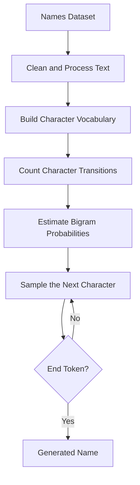

# 🔤 Makemore — Character-Level Language Modeling

<p align="center">
  
  
  
</p>

> Learning how machines generate names by predicting one character at a time.

## 🎯 Overview

Makemore is my exploration of character-level language modeling, following [Andrej Karpathy's Zero to Hero series](https://karpathy.ai/zero-to-hero.html).

The goal is to understand how a model learns patterns from a collection of names and uses those patterns to generate new character sequences.

I am starting with a statistical bigram model before progressing toward neural network-based language models.

## 📂 Project Structure

```text
makemore/
├── dataset.txt
├── makemore.py
└── README.md
```

- `dataset.txt` — the text dataset used for training.
- `makemore.py` — data processing and the current bigram implementation.
- `README.md` — explanations, experiments, and implementation notes.

## 🧩 What Is a Bigram Model?

A bigram model predicts the next character using only the current character.

For example, given the name:

```text
emma
```

The character transitions are:

```text
. → e
e → m
m → m
m → a
a → .
```

Here, `.` represents the beginning or end of a name, depending on the transition. A consistent implementation must distinguish the boundary roles appropriately when encoding the training examples.

The model estimates the probability of a next character given the current one:

\[
P(c_{t+1}\mid c_t)
\]

It does not remember the entire preceding sequence. Its prediction depends only on the current character.

## 🔬 How It Works



### Step 1 — Prepare the dataset

Read the names, normalize the text as required, and define how sequence boundaries are represented.

### Step 2 — Build the vocabulary

Identify the unique characters and assign each one an index when using a numerical representation.

### Step 3 — Count transitions

For every adjacent character pair, increment the corresponding transition count.

A dictionary-based representation can be used to count these pairs before introducing a probability matrix.

### Step 4 — Estimate probabilities

Convert counts into conditional probabilities by normalizing the outgoing transitions for each current character.

\[
P(j\mid i)
=
\frac{N(i,j)}{\sum_k N(i,k)}
\]

Here, \(N(i,j)\) is the number of times character \(j\) follows character \(i\).

### Step 5 — Generate names

Start with the beginning token, sample a next character from the learned distribution, and continue until the end token is sampled.

## 🧮 A Small Example

Suppose the dataset contains these names:

```text
anna
anne
```

The character `n` is followed by `n`, `a`, and `e` across different occurrences, depending on the observed transitions.

A bigram model records the frequencies of these transitions and converts them into probabilities.

If a character is followed by `a` in 6 observations and by `e` in 4 observations, then:

\[
P(a\mid c)=\frac{6}{10}=0.6
\]

\[
P(e\mid c)=\frac{4}{10}=0.4
\]

The next character can be sampled from this distribution. Repeating the process generates a sequence that reflects the transition patterns learned from the dataset.

*These numbers are illustrative, not measured results from the current dataset.*

## 🧠 What I Am Learning

| Concept | Why it matters |
|---|---|
| Character vocabulary | Defines the model's available symbols |
| Sequence boundaries | Determines how names start and end |
| Transition counts | Captures observed character patterns |
| Conditional probability | Converts counts into a predictive distribution |
| Sampling | Turns predictions into generated text |
| Loss functions | Provide a way to evaluate predictions |
| Neural language models | Learn more flexible patterns than simple transition counts |

## ▶️ Running the Implementation

From the repository root:

```bash
uv sync
uv run python makemore/makemore.py
```

This assumes the script uses the repository's configured environment and resolves `dataset.txt` correctly. If the script expects a working directory inside `makemore/`, run it from that directory or update the dataset path to be relative to the script.

## 🔭 Where This Goes Next

The bigram model is the starting point, not the final goal.

Planned extensions include:

- [ ] Validate the character vocabulary and boundary-token handling.
- [ ] Inspect transition counts and visualize probability distributions.
- [ ] Generate names and evaluate the results.
- [ ] Introduce a quantitative loss such as negative log-likelihood.
- [ ] Implement a neural network language model.
- [ ] Compare the statistical bigram model with the neural model.
- [ ] Study embeddings, hidden layers, and gradient-based optimization.
- [ ] Progress toward deeper language models and transformers.

Only mark an item complete when the implementation and experiments are actually available in the repository.

## 📚 References

- [Andrej Karpathy — Zero to Hero](https://karpathy.ai/zero-to-hero.html)
- [Andrej Karpathy — Makemore](https://github.com/karpathy/makemore)

This repository contains my learning implementations and experiments inspired by these educational resources.
