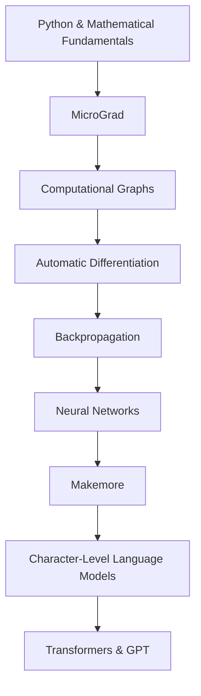

# 🧠 Neural Nets From Scratch

<p align="center">
  <strong>Understanding deep learning by implementing it, one concept at a time.</strong>
</p>

<p align="center">
  
  
  
</p>

<p align="center">
  A hands-on journey through neural networks, automatic differentiation,
  language modeling, and the foundations of modern deep learning.
</p>

---

## 🎯 About This Repository

This repository documents my implementation of concepts from **[Andrej Karpathy's Zero to Hero](https://karpathy.ai/zero-to-hero.html)** series.

My goal is not just to reproduce tutorial code. I want to understand the mathematics behind each component, implement the underlying mechanisms, experiment with the results, and explain why everything works.

I am building from the fundamentals upward — starting with scalar derivatives and computational graphs, then moving toward character-level language models and eventually transformers.

### 🧭 Learning Roadmap

| Module | Focus | Status |
|---|---|---|
| [01 — MicroGrad](./01-microGrad/) | Automatic differentiation, computational graphs, backpropagation, and MLPs | 🚧 Implemented; documenting |
| [02 — Makemore](./makemore/) | Character-level language modeling and bigram probabilities | 🚧 In progress |
| 03 — MLP Language Models | Neural language modeling and training | 📋 Planned |
| 04 — Activations & Initialization | Activation statistics, initialization, and gradient flow | 📋 Planned |
| 05 — WaveNet | Deeper architectures for character-level prediction | 📋 Planned |
| 06 — Building GPT | Self-attention and transformer architecture | 📋 Planned |
| 07 — GPT-2 | Understanding a larger GPT implementation | 📋 Planned |

*The roadmap is an evolving plan based on the series. Module names and status will be updated as implementations progress.*

---

## 🧩 How the Pieces Fit Together



Each stage builds on concepts introduced earlier. The objective is to understand the complete path from mathematical operations to a trained language model.

---

## 🛠️ Tech Stack

- **Python** — primary implementation language
- **NumPy** — numerical operations where appropriate
- **PyTorch** — for learning and comparing implementations when needed
- **Git & GitHub** — version control and progress tracking
- **uv** — Python project and dependency management
- **Jupyter Notebook** — optional interactive experiments

The focus is on understanding the mechanisms, not hiding them behind high-level libraries.

---

## 🔬 My Implementation Approach

For each major concept, I aim to:

1. **Understand** the mathematical idea and the problem it solves.
2. **Implement** the core logic in Python.
3. **Verify** the implementation using small examples and tests.
4. **Experiment** with parameters, edge cases, and alternative approaches.
5. **Document** the reasoning, observations, and limitations.

I also use this repository to record mistakes and debugging lessons because understanding why an implementation fails is part of learning how it works.

---

## 📂 Repository Structure

```text
Neural-Nets_from-scratch/
│
├── 01-microGrad/
│   ├── graphs/
│   ├── micrograd.py
│   ├── MLP.py
│   ├── main.py
│   └── README.md
│
├── makemore/
│   ├── dataset.txt
│   ├── makemore.py
│   └── README.md
│
├── .gitignore
├── .python-version
├── pyproject.toml
├── uv.lock
└── README.md
```

The structure will evolve as new implementations, tests, and experiments are added.

---

## 📚 Learning Resources

- [Zero to Hero — Andrej Karpathy](https://karpathy.ai/zero-to-hero.html)
- [MicroGrad — GitHub](https://github.com/karpathy/micrograd)
- [Makemore — GitHub](https://github.com/karpathy/makemore)
- [Neural Networks: Zero to Hero — YouTube](https://www.youtube.com/@AndrejKarpathy)

The original projects are learning references. This repository contains my own learning notes, implementations, experiments, and explanations.

---

## 🚧 Current Focus

**Current module: Makemore**

I am working on character-level language modeling, beginning with bigram statistics and probability-based text generation.

My immediate objectives are to understand how a dataset becomes a vocabulary, how character transition probabilities are estimated, and how a simple statistical model generates new sequences.

---

## 📌 Project Philosophy

> Don't just use the abstraction. Understand what happens underneath it.

This repository is a continuous learning project. Implementations, explanations, and results will be refined as my understanding improves.

⭐ If you are also learning deep learning from first principles, feel free to explore the implementations and follow along.
